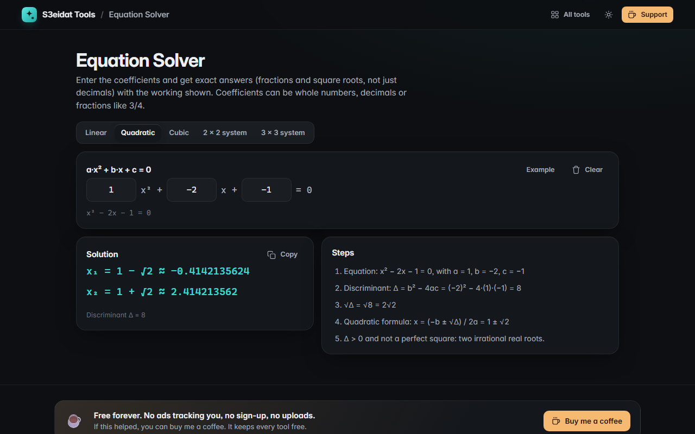

# Equation Solver

> Linear, quadratic and cubic equations and 2 × 2 or 3 × 3 linear systems, with exact answers and steps. Free, private, and it runs entirely in your browser.

### ▶ [Open Equation Solver](https://s3eidat.github.io/equation-solver/)



## Features

- **Exact arithmetic**: coefficients can be whole numbers, decimals or fractions (`3/4`, `-1 1/2`, `2.5e-1`) and are kept as exact fractions (BigInt), never rounded
- **Linear** `ax + b = c`, including "no solution" and "every x"
- **Quadratic** `ax² + bx + c = 0`: discriminant, rational roots with the factored form, irrational roots as simplified square roots (`1/2 ± √5/2`), **complex roots** (`−1 ± 2i`), repeated roots
- **Cubic** `ax³ + bx² + cx + d = 0`: rational root test and synthetic division for exact roots; otherwise the trigonometric method or Cardano's formula with Newton polishing, including the complex pair
- **2 × 2 and 3 × 3 systems** by Gauss–Jordan elimination with every row operation and matrix shown; detects **no solution** and **infinitely many** (given in terms of a parameter `t`)
- Copy the solution

## Privacy

Nothing leaves your device. There is no server, no account, no analytics.
The page ships with a strict Content-Security-Policy (`connect-src 'self'`), so the browser
itself blocks any attempt to send data anywhere.

## Run it yourself

It's plain HTML, CSS and JavaScript with no build step:

```bash
git clone https://github.com/s3eidat/equation-solver
cd equation-solver
python -m http.server 8000
```

Then open http://localhost:8000.

## Support

If this saved you time, **[buy me a coffee ☕](https://s3eidat.github.io/coffee/)**. It keeps every tool free.

---

Part of **[S3eidat Tools](https://s3eidat.github.io/)**: 100+ free, private tools that run in your browser. MIT licensed.
